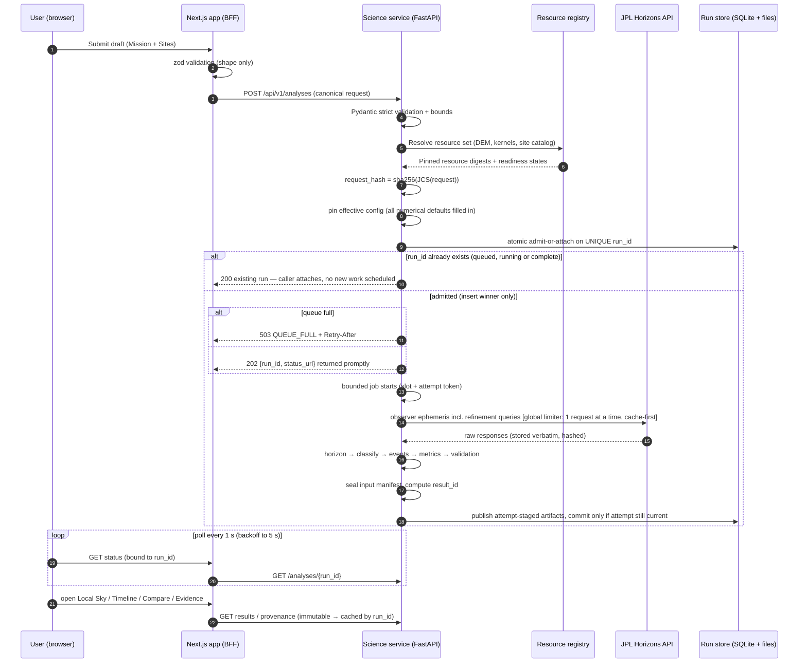
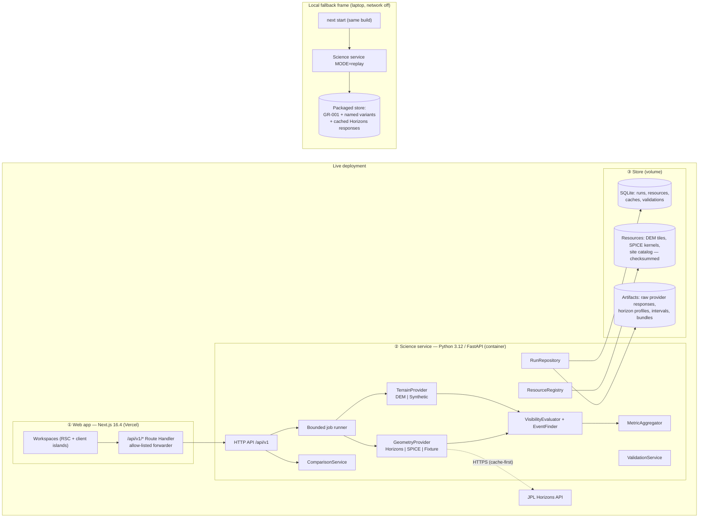
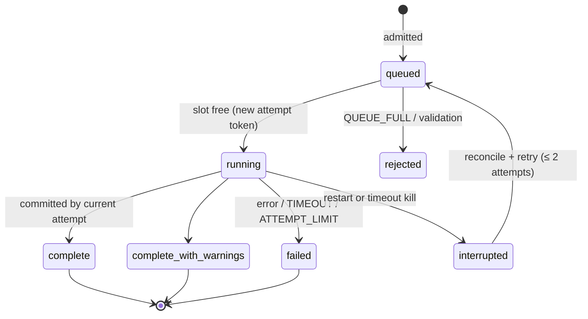
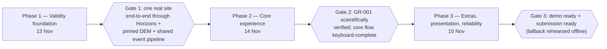

# LunaScope — Implementation Specification Plan

**Derived from:** *LunaScope Product and Technical Specification v2.1 (+ v2.1.1 clarifications)*, `.md` and `.pdf` at the repo root
**Codebase analysed:** `luna_scope_2` @ `81adcd0` (Create Next App scaffold)
**Date:** 13 Nov 2026 · **Revision:** v1.1 — incorporates *LunaScope: Implementation Plan Review* (items I-01 to I-07 plus follow-through) · **Status:** engineering plan — contains **no computed lunar result**

> This document turns the product spec into something you can build from: how the product works end to end, the exact module boundaries, algorithms, data contracts, storage, frontend architecture on Next.js 16.4, testing, deployment and the build order. Where the product spec leaves a decision open, this plan says so and proposes a default, marked **[Proposed]**. Where it found a problem in the spec, it is listed in §17.

---

## Contents

1. [Current codebase analysis](#1-current-codebase-analysis)
2. [How the product works (end to end)](#2-how-the-product-works-end-to-end)
3. [System architecture](#3-system-architecture)
4. [Repository layout](#4-repository-layout)
5. [Science engine — canonical observer and geometry](#5-science-engine--canonical-observer-and-geometry)
6. [Science engine — terrain horizon](#6-science-engine--terrain-horizon)
7. [Science engine — visibility, events and metrics](#7-science-engine--visibility-events-and-metrics)
8. [Run lifecycle, identity and job execution](#8-run-lifecycle-identity-and-job-execution)
9. [Resource registry and provenance](#9-resource-registry-and-provenance)
10. [Storage design (SQLite + artifacts)](#10-storage-design-sqlite--artifacts)
11. [API contracts](#11-api-contracts)
12. [Frontend architecture (Next.js 16.4)](#12-frontend-architecture-nextjs-164)
13. [Workspaces — screen-level spec](#13-workspaces--screen-level-spec)
14. [Testing and validation plan](#14-testing-and-validation-plan)
15. [Deployment, offline fallback, observability, security](#15-deployment-offline-fallback-observability-security)
16. [Build plan, phases and gates](#16-build-plan-phases-and-gates)
17. [Spec review — gaps, contradictions, decisions needed](#17-spec-review--gaps-contradictions-decisions-needed)
18. [Traceability matrix](#18-traceability-matrix)

---

## 1. Current codebase analysis

### 1.1 What exists

| Item | Finding | Implication |
| --- | --- | --- |
| Framework | `next@16.4.6`, `react@19.3.0`, `react-dom@19.3.0`, App Router only (`app/`) | Use the bundled docs in `node_modules/next/dist/docs/` — APIs differ from older Next (see §12.1) |
| `next.config.ts` | `cacheComponents: true`, `partialPrefetching: true`, `experimental.agentFeedback: true`, Turbopack CSS rule using `@tailwindcss/turbopack` | Cache Components model is on: runtime data must sit behind `<Suspense>`, caching is opt-in via `'use cache'` |
| Styling | Tailwind CSS `4.3.3` via the Turbopack loader (no PostCSS config), `@theme inline` tokens in `app/globals.css` | Design tokens go in `@theme`; no `tailwind.config.js` |
| Types | `strict: true`, path alias `@/*` → repo root, global `LayoutProps<"/">` helper used in `layout.tsx` | Use the typed `PageProps<'/route'>` / `LayoutProps` helpers; `params`/`searchParams` are Promises |
| Lint | ESLint 9 flat config with `eslint-config-next` core-web-vitals + typescript | Add `science/**` and `data/**` to `globalIgnores` |
| App code | `app/page.tsx` is the stock template; `layout.tsx` metadata still "Create Next App" | Everything product-related is still to be built |
| Backend | None. No Python, no API, no store | The whole science service (§5–§11) is greenfield |
| Tests | None (no Vitest, Playwright, pytest) | Test harnesses are part of Phase 1 |
| Docs | Spec v2.1 as `.md` and `.pdf`. In the Markdown, two figures appear only as placeholders (`architecture · 3 parts plus a local fallback frame`, `plan · 3 phases, 3 gates`). **Correction (review):** I extracted the PDF as text only (no page renderer was available), so I could not confirm whether the PDF itself contains those figures — it likely does | Treat §3.1 and §16.1 as *reconstructions from the text*; compare them against the PDF figures by eye and prefer the PDF where they differ |
| `README.md` | Stock text plus a trailing line `#   L u n a S c o p e` that is **UTF-16LE** bytes appended to a UTF-8 file (`#\0 \0L\0u\0…`) — almost certainly from PowerShell `echo >>` | Rewrite README as UTF-8 in Phase 1; it is the judges' entry point |
| `.gitignore` | Ignores `.env*`, `.next`, `node_modules` | Add `science/.venv`, `data/raw/`, `data/derived/`, `var/` (run store) |
| `AGENTS.md` | Injected by `next dev`: "read the bundled Next docs before coding" | Keep it; follow it |

### 1.2 Gap summary

```
Spec needs                         Scaffold has
─────────────────────────────────  ───────────────
Python science service (FastAPI)   –
Geometry: Horizons + SPICE         –
Terrain horizon engine + DEM       –
Event / interval / metric engine   –
Run store (SQLite + files)         –
Resource registry + manifests      –
BFF API layer in Next              –
7 workspaces + Home                stock page
Charts (polar sky, timeline)       –
Test suites (pytest/Vitest/PW)     –
Offline fallback package           –
Deploy config (Vercel + container) –
```

The scaffold is a clean starting point with modern defaults; nothing needs to be undone except the template page, metadata and README.

---

## 2. How the product works (end to end)

### 2.1 The one-paragraph model

A user describes a **mission window** (start, duration, step) and **requirements** (≥ X % sunlight, ≥ Y % Earth visibility), picks **sites**, and submits. The Python service builds one **canonical observer** per site, fetches **Sun and Earth azimuth/elevation** for every time sample from **JPL Horizons** (checked against an independent **SPICE** calculation), computes the **terrain horizon** — the elevation angle of the skyline in every direction — from a pinned **lunar DEM**, and for each sample computes the clearance `d = target_el − horizon_el(target_az) − margin`. Signs of `d` become **visible / hidden / unresolved** intervals, refined to precise **rise/set events**. Interval durations become **availability bounds, windows, outages and pass/fail per target**. Everything is stored as an **immutable run**: a stable `run_id` (known at admission, used for polling) and a content-derived `result_id` sealed when all contributing inputs are known (§8.1). The web app only **displays**: the local sky, timelines, comparisons, the countdown and the evidence.

### 2.2 What happens when the user presses "Run"



### 2.3 What the user sees, by flow

| Flow | Steps the product performs | Where the logic lives |
| --- | --- | --- |
| **A. Baseline** | Home → "Start reference mission" pre-fills the 7-day / 60 % / 50 % / terrain-on draft → Sites shows presets with source + precision → review sample count (e.g. 1,009) and coverage → submit → status matrix per site (PASS / FAIL_SUN / … / UNKNOWN) → drill into Local Sky + Timeline → export | Draft: browser. Everything numeric: service |
| **B. Delay (Time Machine)** | From a finished run, shift start by N days → service creates a **linked variant** (`variant_type=date_shift`, `changed_fields=[start]`) with everything else frozen → comparison endpoint returns deltas, changed intervals, pass/fail flips under a declared alignment mode | `POST /analyses/{id}/variants`, `POST /comparisons` |
| **C. Review** | Evidence shows provider request/response hashes, SPICE residuals, DEM manifest, observer, corrections, time scale, code version, three validation cards; downloads the evidence bundle | `GET /provenance`, `GET /export` |

### 2.4 The three non-negotiable rules, as engineering invariants

| Product rule | Engineering invariant | Enforced by |
| --- | --- | --- |
| No placeholder shown as science | Every response carries `result_state ∈ {synthetic_demonstration, real_data_unverified, validated:<scope>}`; UI wraps every result surface in `<ResultStateFrame>` which renders the persistent label; export refuses `verified=true` unless state is `validated` | Pydantic model (required field), React component, export guard, test AC-13 |
| Unknown ≠ not visible | Three-way classification; `unknown_s` is never folded into `hidden_s`; nodata → `None`, never `0` | Type system (`Optional[float]` horizon samples), aggregator tests |
| No hidden score | No field anywhere named `score`/`rank`; comparison returns per-target, per-requirement results only | Contract lint test that greps schemas; review checklist |

---

## 3. System architecture

### 3.1 Reconstructed figure: "3 parts plus a local fallback frame"



**Responsibilities (hard boundary):**

- **Web app** — collects drafts, validates *shape*, forwards to the service, renders. It may (per spec §10) pick an already-classified interval, format values, interpolate *display* directions for animation, and subtract cursor time from an event time for the countdown. It **never** computes clearance, availability, deltas, rankings or causes.
- **Science service** — the only place where visibility, events, metrics, comparisons and explanation facts are computed. Numerical modules do **no file or network I/O**; providers inject data.
- **Store** — SQLite for metadata (one file, WAL mode), plain files for artifacts, both behind `RunRepository` so a hosted DB can replace it later.

### 3.2 Why a BFF instead of the browser calling FastAPI directly

1. Same origin → no CORS, the service URL and any token stay server-side (`SCIENCE_API_URL`, `SCIENCE_API_TOKEN` are not `NEXT_PUBLIC_`).
2. Allow-listed endpoint map (pattern from the bundled `backend-for-frontend.md`): a caller cannot steer the request to another host.
3. Server Components can read immutable completed runs through a cached function (`'use cache'`, keyed by `run_id`), giving instant navigation between workspaces.

### 3.3 Technology choices

| Concern | Choice | Reason |
| --- | --- | --- |
| Web | Next.js 16.4 App Router, React 19.3, TypeScript strict, Tailwind 4 | Already scaffolded |
| Charts | Hand-built SVG with `d3-scale`, `d3-shape`, `d3-array` (no full d3, no chart lib) | Polar sky and banded timelines are bespoke; SVG gives a11y hooks; tiny bundle |
| Animation | `requestAnimationFrame` on a `<canvas>` overlay for moving markers; SVG for static layers | 1,009+ samples × 2 targets animate smoothly; static horizon stays crisp and accessible |
| Client validation | `zod` | Field-level messages (FR-01) |
| API types | Generated from FastAPI OpenAPI via `openapi-typescript` → `lib/api/schema.d.ts` | One source of truth: Pydantic |
| Service | Python 3.12, FastAPI, Pydantic v2 (`strict=True`, `extra="forbid"`), Uvicorn (1 worker) | Spec §10/§12 |
| Numerics | NumPy, SciPy (`brentq`, `CubicHermiteSpline`), SpiceyPy, Rasterio, pyproj | Spec references |
| HTTP client | `httpx` with timeouts + retries (Horizons) | |
| Packaging | `uv` + `pyproject.toml`, lockfile committed; Docker image | Pinned deps (NFR-06) |
| Logs | `structlog` JSON | NFR-08 |
| Tests | pytest + hypothesis (science), FastAPI TestClient, Vitest + Testing Library, Playwright + `@axe-core/playwright` | Spec §12 |

---

## 4. Repository layout

The Next.js app stays at the repo root (no churn to the scaffold); the service lives in `science/`.

```
luna_scope_2/
├─ app/                              # Next.js App Router (web)
│  ├─ layout.tsx                     # shell, fonts, <DataStatusBanner/>
│  ├─ page.tsx                       # Home: one-click reference mission
│  ├─ mission/page.tsx               # Mission workspace (draft)
│  ├─ sites/page.tsx                 # Sites workspace (draft)
│  ├─ runs/[runId]/
│  │  ├─ layout.tsx                  # run header, result-state frame, workspace tabs
│  │  ├─ page.tsx                    # status matrix (run summary)
│  │  ├─ sky/page.tsx                # Local Sky
│  │  ├─ timeline/page.tsx           # Timeline
│  │  ├─ time-machine/page.tsx       # Time Machine
│  │  └─ evidence/page.tsx           # Evidence
│  ├─ compare/page.tsx               # Compare (?runs=a,b&sites=…&align=elapsed|calendar)
│  ├─ learn/page.tsx                 # FR-19 explainer
│  └─ api/v1/[...slug]/route.ts      # BFF allow-listed forwarder
├─ components/
│  ├─ status/  ResultStateFrame, StatusBadge, WarningChip, DataStatusBanner
│  ├─ sky/     PolarSky, HorizonPath, TargetTrack, SkyPlayer, Countdown
│  ├─ timeline/ TargetBand, IntervalTable, ThresholdLine
│  ├─ compare/ StatusMatrix, PairedTimelines, HeldChangedFields
│  └─ evidence/ ValidationCard, ProvenanceTable, ExportButton
├─ lib/
│  ├─ api/ schema.d.ts (generated), client.ts, server.ts (cached readers)
│  ├─ draft/ mission-schema.ts (zod), draft-store.ts
│  ├─ time/  utc.ts, countdown.ts
│  └─ format/ angles.ts, durations.ts
├─ science/                          # Python service
│  ├─ pyproject.toml, uv.lock, Dockerfile
│  ├─ lunascope/
│  │  ├─ main.py                     # FastAPI app factory, startup checks
│  │  ├─ config.py                   # settings (pydantic-settings), MODE=live|replay
│  │  ├─ api/      health.py resources.py sites.py analyses.py comparisons.py export.py errors.py
│  │  ├─ domain/   request.py result.py events.py provenance.py codes.py
│  │  ├─ observer.py                 # canonical observer + ENU frame
│  │  ├─ providers/
│  │  │  ├─ geometry/ base.py horizons.py spice.py fixture.py interpolate.py
│  │  │  └─ terrain/  base.py dem.py synthetic.py
│  │  ├─ horizon/   engine.py profile.py
│  │  ├─ visibility/ evaluator.py events.py intervals.py
│  │  ├─ metrics/   aggregator.py requirements.py
│  │  ├─ compare/   service.py alignment.py explain.py templates.py
│  │  ├─ registry/  resources.py manifest.py
│  │  ├─ validation/ service.py cards.py
│  │  ├─ store/     repository.py schema.sql artifacts.py
│  │  ├─ jobs/      runner.py
│  │  └─ canonical.py                # JCS canonical JSON + hashing
│  └─ tests/ unit/ reference/ convergence/ api/ fixtures/
├─ data/
│  ├─ manifests/*.json               # committed: one per resource (§9)
│  ├─ sites/catalog.json             # committed: curated sites with provenance
│  ├─ raw/        (gitignored)       # downloaded DEM, kernels
│  └─ derived/    (gitignored)       # tiles, precomputed horizons
├─ fallback/                         # packaged demo (built by script)
├─ e2e/                              # Playwright
├─ docs/                             # this plan, decision records (ADR/SDR)
└─ docker-compose.yml                # web + science, local
```

---

## 5. Science engine — canonical observer and geometry

### 5.1 Canonical observer (spec §8.2)

One immutable object per site per run. Every consumer (Horizons request, SPICE check, terrain engine, validation) is built **from this object only**.

```python
class CanonicalObserver(BaseModel, frozen=True, extra="forbid", strict=True):
    site_id: str
    # source point, as published (kept separate from analysis point — FR-02)
    source_lat_deg: float; source_lon_deg: float
    source_convention: Literal["planetocentric", "planetographic"]
    source_lon_direction: Literal["east_positive", "west_positive"]
    source_reference: str                      # e.g. "LOLA sphere R=1737.4 km, MOON_ME"
    source_citation: str
    source_precision_m: float
    # analysis point (normalised)
    lat_deg: float                             # planetocentric, [-90, 90]
    lon_deg_east: float                        # [0, 360)
    body_frame: Literal["MOON_ME"]             # [Proposed]; OQ-02
    reference_radius_km: float                 # 1737.4 [Proposed]; OQ-02
    ground_height_m: float                     # DEM elevation at point, relative to reference radius
    ground_height_source: str                  # DEM product id + checksum
    observer_height_above_ground_m: float      # user input (e.g. 2.0 m mast)
    # derived
    radius_km: float                           # = R_ref + (ground_height + obs_height)/1000
    position_km: tuple[float, float, float]    # body-fixed Cartesian
    enu: tuple[Vec3, Vec3, Vec3]               # east, north, up unit vectors
    status: Literal["resolved", "OBSERVER_UNRESOLVED"]
```

Rules implemented in `observer.py`:

- **Height conversion is explicit.** `radius = R_ref + h_ground(DEM) + h_obs`. Passing `h_obs` as a height above the reference surface is impossible because the constructor requires both terms (risk #2).
- **Local frame from 3D, not raster north.** `u = r̂`; `e = normalize(ẑ × u)`; `n = u × e`. (Sphere: radial = surface normal. If an ellipsoid is ever used, `u` becomes the ellipsoid normal and this changes in one place.)
- **Pole convention [Proposed].** If `cos(lat) < 1e-9` (within ~0.2 mm of the pole), define `e` from the site longitude: `e = (−sin λ, cos λ, 0)`, `n = u × e`. Documented and covered by a dedicated test; south-pole sites near −89.9° are well-conditioned but tests exercise the singular case.
- **Unresolved → blocked.** If the vertical reference or any convention is unknown, `status=OBSERVER_UNRESOLVED`, which blocks definitive real-data conclusions (warning code).

### 5.2 Angles from a direction vector (spec §8.3)

```
E = v·e,  N = v·n,  U = v·u
azimuth   = atan2(E, N) mod 360°    (clockwise from local north)
elevation = atan2(U, √(E² + N²))
```

Implemented once in `observer.az_el(v)`, used by the SPICE path and the horizon engine. The Horizons path parses Horizons' own az/el, so the two are **independent** implementations (as the spec requires).

### 5.3 `GeometryProvider` contract

```python
class GeometryProvider(Protocol):
    identity: ProviderIdentity     # name, version, settings digest
    def series(self, obs: CanonicalObserver, target: Target,
               times_utc: Sequence[datetime]) -> GeometrySeries: ...
    def at(self, obs, target, t: datetime) -> AzEl: ...   # for root refinement
```

`GeometrySeries` = arrays `t`, `az_deg`, `el_deg`, plus `raw_response_ref` (artifact id + sha256) and `coverage` (start/stop actually returned).

### 5.4 Horizons provider (MVP primary)

**Request** (one per site × target × window; Horizons API, `format=json`):

| Parameter | Value | Note |
| --- | --- | --- |
| `COMMAND` | `'10'` (Sun) / `'399'` (Earth) | Target centre |
| `EPHEM_TYPE` | `'OBSERVER'` | |
| `CENTER` | `'coord@301'` | Topocentric site on the Moon |
| `COORD_TYPE` | `'GEODETIC'` | On a spherical Moon geodetic = planetocentric; confirm in OQ-02 |
| `SITE_COORD` | `'<E-lon deg>,<lat deg>,<height km>'` | From canonical observer; height = `(h_ground + h_obs)/1000` relative to Horizons' lunar reference surface — **must be checked against OQ-02** |
| `START_TIME` / `STOP_TIME` / `STEP_SIZE` | ISO UTC / ISO UTC / `'10 m'` | Base grid; validation runs use `'1 m'` |
| `TIME_TYPE` | `'UT'` | Output in UTC; recorded |
| `QUANTITIES` | `'4'` | Apparent azimuth & elevation |
| `APPARENT` | `'AIRLESS'` | No refraction (no atmosphere — working assumption) |
| `ANG_FORMAT`, `CSV_FORMAT`, `EXTRA_PREC`, `TIME_DIGITS`, `OBJ_DATA` | `'DEG'`, `'YES'`, `'YES'`, `'SECONDS'`, `'NO'` | Machine-parseable |

**Handling:**

1. Cache key (spec §11): `provider, version, observer digest, target, correction mode, time scale, start, stop, step, response signature`. Cache hit → no network.
2. Store the **raw JSON verbatim** as an artifact; record its sha256, retrieval time and the API `signature.version`.
3. Check the JSON for an explicit `error` field (Horizons can return an input error with HTTP 200) and for a supported `signature.version`; HTTP success plus a recorded signature is **not** parser validation. Then parse rows between `$$SOE` and `$$EOE`; assert row count = expected samples, monotonic times, finite angles, `0 ≤ az < 360`, `−90 ≤ el ≤ 90`. Any deviation → `GEOMETRY_COVERAGE_MISSING` (fatal for that site).
4. Network/HTTP failure → if an exactly matching cached response exists use it, else `GEOMETRY_PROVIDER_UNAVAILABLE`. **Never** fall back to different settings.
5. Correction mode is Horizons **apparent** quantity 4 (OQ-03). The SPICE check uses `abcorr='LT+S'`, but **this is not claimed to be exactly equivalent**: Horizons lists further corrections for apparent coordinates, while SPICE `LT+S` is Newtonian light time plus stellar aberration. The residual budget (§5.5) must absorb and document this difference; "like with like" is a goal to be demonstrated, not an assumption.

**Off-grid geometry for event refinement.** Root refinement needs geometry between the 10-minute samples.

- **Interpolation model [Proposed].** Cubic Hermite on the **unit direction vector** `v(t)` (avoids azimuth wrap and pole issues), re-normalised after interpolation. Endpoint derivatives come from the **same-grid central difference of neighbouring Horizons directions** (one-sided at the ends), *not* from a separate source. The Hermite coefficients also give an exact per-segment bound on `|dv/dt|`, which §7.2 uses.
- **Holdout test.** On each run family, request a **withheld** finer series (using Horizons `TLIST` discrete times or a short fine-step window) at times *not* used to build the spline. Measure the angular residual `δ_geom` (max over holdout, per target). This is a recorded provenance field, not a one-off check.
- **Timing consequence.** A clearance error of `δ_geom` shifts a locally monotonic crossing by about `δ_geom / |dd/dt|`; near a tangent `|dd/dt| → 0` and the conversion is unstable, so those events get `quality = near_tangent` and **no timing bound is claimed**. This `geometry_timing_bound_s` is reported next to the solver bracket.
- **Solver bracket ≠ prediction accuracy.** A 1-second Brent bracket is only the bracket of the *interpolated model* and is labeled as such.
- **Fallback.** If `δ_geom` is too large for the declared event tolerance (or an event is near-tangent), query Horizons **directly** at the bracket via `TLIST` (sub-minute times; cache-first, one-at-a-time per the fair-use limiter in §15.4), or use a validated local SPICE provider once it passes its own checks. A 1-minute grid is *not* sufficient on its own to certify sub-minute accuracy.

### 5.5 SPICE provider (independent check, later offline primary)

- Kernels **[Proposed, pin in OQ-03]**: `naif0012.tls` (leap seconds), `pck00011.tpc`, a DE440-family SPK (`de440s.bsp` covers 1849–2150 and is ~32 MB), `moon_pa_de440_200625.bpc` (lunar orientation), the matching lunar frames kernel `moon_de440_*.tf` (defines `MOON_ME`/`MOON_PA`). Each gets a manifest entry with checksum and coverage.
- Computation: `spiceypy.azlcpo(method="ELLIPSOID", target="SUN"|"EARTH", et, abcorr="LT+S", azccw=False, elplsz=True, obspos=position_km, obsctr="MOON", obsref="MOON_ME")` gives range/az/el directly, **or** `spkcpo` + our own `az_el()`; the plan uses `spkcpo` + `az_el()` for the SPICE path so the local-frame math is itself under test, and uses `azlcpo` as a third cross-check in unit tests only.
- Time: UTC → ET via `str2et` with the LSK; the conversion is recorded.
- **Frame realization.** Shared names such as `MOON_ME` do not prove identical realizations. Pin the lunar frame kernel/realization used by SPICE, the frame Horizons uses for `coord@301`, the output-frame epoch, and the DEM's frame, and state the documented residual budget that covers their differences (see S-6).
- Used at **selected epochs** (e.g. 50 per site spread over the window, plus every refined event time). Residuals: wrapped `Δaz = ((az₁ − az₂ + 180) mod 360) − 180` and `Δel`. Tolerance **[Proposed]** 0.01° for el, 0.01°/cos(el) for az — set after the first comparison (OQ-08). Exceeding it → `GEOMETRY_REFERENCE_MISMATCH`.

> Independence rule: the SPICE check must never be validated against a fixture produced by the Horizons path (or vice versa). Fixtures carry `produced_by`.

### 5.6 Fixture provider (synthetic demonstration)

Deterministic analytic tracks (e.g. Sun circling at el = 1.5° + 1.5° sin(...)), used for UI development, tests and the clearly labeled demo. Every series it produces has `result_state=synthetic_demonstration`; the repository refuses to mix fixture and real geometry inside one run.

---

## 6. Science engine — terrain horizon

### 6.1 `TerrainProvider` contract

```python
class TerrainProvider(Protocol):
    identity: TerrainIdentity          # product id, version, checksum, CRS, ref surface, units, res, nodata
    def elevation_m(self, lat: ndarray, lon: ndarray) -> ndarray:   # NaN where nodata/outside
    def coverage(self, footprint: Polygon) -> CoverageReport: ...
```

Implementations: `DemTerrain` (Rasterio-backed, memory-mapped tiles) and `SyntheticTerrain` (flat sphere, single ridge, crater, depressed skyline — analytic, for tests).

### 6.2 Candidate DEMs (to inspect; **not** a selection — OQ-01)

| Candidate | Why consider | Must verify |
| --- | --- | --- |
| LOLA south-polar gridded DEMs in polar stereographic (e.g. 20 m/px product covering 80°S–90°S, from PDS Geosciences LOLA archive) | Native south-pole coverage, documented sphere reference (R = 1737.4 km), published accuracy | Exact product ID/version, nodata, vertical datum, use terms, horizon footprint extent |
| Higher-resolution LOLA site DEMs (e.g. ~5 m/px near candidate landing regions) | Better local ridges | Footprint is small → distant terrain must come from a coarser layer (multi-resolution merge) |
| QuickMap / Moon Trek exports | Discovery and visual cross-check only | Spec: portals are **not** a pinned numerical input |

**[Proposed] sequencing.** For the first real-site integration use **one sufficiently covering approved DEM product** (full horizon footprint at the chosen radius). Add a finer near-field layer only after the base pipeline is correct. A multi-resolution merge adds obligations — shared frame and reference surface, seam handling, per-layer coverage and a recorded layer for each azimuth maximum — and is therefore a later increment, not a first-slice requirement. Final product scope is unchanged.

### 6.3 Coordinate handling

- Polar stereographic projection of the DEM is read from its label/CRS (e.g. `+proj=stere +lat_0=-90 +lon_0=0 +k=1 +R=1737400 +units=m`). `pyproj` converts sample lat/lon → x/y. **Pixel-is-area vs pixel-is-point** is read from metadata and tested (raster-handling layer).
- Interpolation: bilinear on the four surrounding cells; if any is nodata → NaN (unknown). Never zero.

### 6.4 Horizon algorithm (spec §8.4, made concrete)

For observer position **P** (body-fixed, km) with ENU `(e, n, u)`:

```
for each azimuth bin α_k = k·Δα, k = 0..(360/Δα − 1):
    direction on the tangent plane: t = sin α·e + cos α·n
    for each surface distance s_j in the radial schedule (0 < s_j ≤ R_max):
        point on the reference sphere along the great circle from the site:
            Q̂ = cos(s_j/R)·û + sin(s_j/R)·t           (unit vector)
        z = DEM elevation at Q̂ (m)  → NaN if nodata
        Q = (R + z/1000)·Q̂
        w = Q − P
        θ_j = atan2(w·u, |w − (w·u)u|)                 (3D elevation angle incl. curvature)
    horizon[k] = max_j θ_j over valid samples
    record argmax distance s*, cell (row, col), layer id
    if any sample along the ray is NaN and its θ upper bound could exceed the max:
        mark sector k as "coverage-limited" (unknown)
```

- **Radial schedule [Proposed]:** step = ½ DEM pixel out to 2 km, then growing geometrically (×1.02 per step) but **capped at one pixel of the coarsest layer in range**. With a 20 m far field and a 150 km radius this means on the order of **7,500 steps per ray** before any near-field refinement — the earlier "~3,000" estimate was wrong. 720 azimuths × ~7,500 ≈ 5.4 M lookups per site at default settings (more at 0.1° / 200 km).
- **Missing terrain is unknown by default.** A nodata gap or uncovered sector makes the affected azimuths `coverage_limited` **unless** one of these is recorded in the profile: (a) an approved overlapping source covers the gap, or (b) a separately justified conservative elevation bound applies to the *missing region itself*. A maximum computed from valid cells of the same tile is **not** such a bound and must not be used.
- **Between-ray obstacles.** Fixed azimuth rays plus linear interpolation do not certify that every obstacle between rays was captured. Keep the az/radius refinement study and adversarial narrow-ridge tests, and report results as *"numerically converged under tested settings"*, never *"all physical obstacles resolved"*.
- **Vectorisation and memory.** Evaluate in tiles/chunks (e.g. 64 azimuth rows at a time), bilinear gather, max over the radial axis; chunk boundaries are also the cooperative-cancellation points (§8.3). The 20 s budget is a **target to be measured** at the finest allowed settings (time and peak memory), not an expectation.

### 6.5 Horizon profile artifact

```json
{
  "profile_id": "sha256(...)",
  "site_id": "…", "observer_digest": "…",
  "dem": [{"product_id": "…", "sha256": "…", "role": "near|far"}],
  "settings": {"radius_km": 150, "az_step_deg": 0.5, "radial_schedule": "v1", "interp": "bilinear"},
  "algorithm_version": "horizon-1.0.0",
  "azimuth_deg": [0.0, 0.5, …],
  "horizon_el_deg": [ … | null ],
  "argmax_distance_km": [ … ],
  "sector_state": ["certified" | "coverage_limited" | "unsupported"],
  "warnings": ["DEM_COVERAGE_INCOMPLETE:az=112.5-118.0"]
}
```

**Lookup at target azimuth:** circular linear interpolation between neighbouring bins (wraps 359.5° → 0°). If either neighbour is `null`/not certified → unknown. Cache key per spec §11 (site, observer, DEM product + checksum, reference surface, radius, az step, interp, clearance policy, algorithm version). Showcase presets are precomputed and loaded in < 300 ms.

---

## 7. Science engine — visibility, events and metrics

### 7.1 Decision variable and classification

```
d(t) = el_target(t) − h(az_target(t)) − m        (m = clearance margin, default 0)
flat-horizon variant: h ≡ 0
```

| Condition | Class |
| --- | --- |
| geometry or horizon unknown at t | `U` (unresolved – coverage) |
| `d > +ε` | `V` visible |
| `d < −ε` | `H` hidden |
| `|d| ≤ ε` | `U` (unresolved – near boundary) |

ε is the **numerical decision band**, chosen and justified in SDR-001 (never a statistical CI, never shrunk to a temporal root bracket for convenience).

**Single uncertainty and requirement policy (replaces the competing S-1 / S-9 variants).**

1. **Exclusion** — missing required inputs, fatal validation failures, and **uncertified event-search regions** exclude the case (`EXCLUDED`, reason code attached).
2. **Propagation** — approved, bounded numerical crossing uncertainty (the ε band and refined-but-uncertain boundaries) is *not* an exclusion: it stays as unresolved time `U` and flows into the availability bounds.
3. **Per-requirement outcome**, per target, from the bounds `[lower, upper]` against the threshold `θ`:
   - `PASS` if `lower ≥ θ`
   - `FAIL` if `upper < θ`
   - `INDETERMINATE` otherwise
4. A root bracket locates a zero of the adopted model; it never erases other reasons clearance is unresolved. Reducing the angular band to a temporal bracket requires an explicitly justified numerical-error model recorded in SDR-001.

Note the depressed-skyline case falls out naturally: `el = −0.2°`, `h = −0.4°` → `d = +0.2°` → visible (test case 6).

### 7.2 Event finding (spec §8.6 and §9.1)

Three separate responsibilities (they must not be merged into one "find the root" step):

| Responsibility | What it finds | How |
| --- | --- | --- |
| **Physical-model events** | Crossings and contacts of `d = 0` | Isolate one crossing per bracket, then refine |
| **Class-partition boundaries** | Entry/exit of the unresolved band: crossings of `d = +ε` and `d = −ε` | Same machinery applied at levels `±ε` |
| **Certification** | That an interval has *no* crossing of a level `c ∈ {−ε, 0, +ε}` | Conservative bound below; else subdivide |

**Certification test.** For a base interval `[a, b]` of width `w` and level `c`:

```
certified_no_crossing  ⇔  |d(mid) − c|  >  L·w/2 + δ_geom
L  =  bound on |d'(t)| over [a,b]   (conservative, see below)
```

`L` must be a **bound over the whole interval**, not an estimate from sampled rates:
- elevation-rate bound from the **Hermite segment polynomial** (exact derivative bound via Bernstein/norm bound on its coefficients);
- plus `max |dh/dα|` over **every horizon-bin segment crossed** by the interval's azimuth range `[α_min, α_max]` (all knots between, not just the endpoint bins) × an azimuth-rate bound from the same polynomial;
- `δ_geom` is the measured interpolation residual (§5.4). If no valid bound can be formed, the interval is **not** certified.

Note this tests the actual classified function: an interval can stay positive yet dip into the `(−ε, +ε)` band, so certification is done **per level**, not just against zero.

**Subdivision.** Uncertified interval → bisect; recurse until each piece is certified for all three levels, or a stop rule fires (minimum width `w_min` default 5 s, or evaluation cap default 200 per base interval). Uncertified at stop → mark that sub-interval **unresolved (uncertified)** — which is an *exclusion* trigger (§7.1 policy), never "no event".

**Root refinement.** Brent's method is applied **only** to a bracket in which `d'` has been certified of one sign (so the bracket contains exactly one root). A sign change alone does not prove a single root. Report the bracket as the *solver bracket of the interpolated model* plus `geometry_timing_bound_s` (§5.4).

**Contacts and extrema.** No golden-section search as a general detector (the skyline is piecewise and need not be unimodal). A *contact* (touch without crossing) is reported only when derivative-sign analysis brackets a unique stationary point inside one smooth segment whose extremum value lies within ε of the level and does not change sign. Otherwise the region stays unresolved.

**Ordering** (unchanged): events sort by time, then by fixed tie-break `(set, contact, rise)`; at an event instant the interval *starting* there is the current state; mission end is a **censored** boundary, not a set.

### 7.3 Event object

```json
{
  "event_id": "run:site:target:seq",
  "run_id": "…", "site_id": "…", "target": "sun_center",
  "type": "rise | set | contact",
  "horizon": "terrain | flat",
  "t_utc": "2027-…Z",
  "solver_bracket_s": 0.8, "geometry_timing_bound_s": 2.0,
  "quality": "normal | near_tangent | coverage_limited | censored",
  "az_deg": 0.0, "horizon_el_deg": 0.0,
  "obstacle": {"distance_km": 0.0, "layer": "near"}
}
```

### 7.4 Interval partition and metrics (spec §8.5)

The engine outputs, per site × target × horizon definition, an ordered list of **classified intervals** `[(t_start, t_end, class, reason)]` that exactly tile the mission window. All metrics derive from these intervals by duration (never by sample count, because sampling is adaptive).

| Metric | Formula |
| --- | --- |
| `T` | mission duration (s) |
| `visible_s`, `hidden_s`, `unknown_s` | Σ durations by class; `T = V + H + U` asserted to 1 ms |
| `availability_lower` | `V / T` |
| `availability_upper` | `(V + U) / T` |
| `known_time_fraction` | `V / (V + H)` if `V + H > 0` else `null` — labeled conditional |
| windows | maximal runs of `V` |
| outages | maximal runs of `H` (known) |
| `longest_known_hidden_s` | max outage duration, with start/end UTC |
| `worst_case_not_visible_s` | Longest maximal run of `H ∪ U` (anything not certified visible). Includes **unknown-only spans and spans touching the mission edges** (flagged `censored`). The narrower "known hidden" statistic stays separately named `longest_known_hidden_s` |
| `requirement_outcome` (per target) | `PASS` (`lower ≥ θ`), `FAIL` (`upper < θ`), `INDETERMINATE` (otherwise), or `EXCLUDED` (missing required inputs, fatal validation failure, or uncertified event-search region). Both signed margins are stored: `lower − θ` and `upper − θ`, unrounded |

**Site summary (derived from stored per-target outcomes; indeterminate/unknown is never a failed target):**

| Condition | Site status code |
| --- | --- |
| Site-level fatal (observer unresolved, geometry coverage missing) | `UNKNOWN_COVERAGE` (excluded) |
| Any target `FAIL` | `FAIL_SUN` / `FAIL_EARTH` / `FAIL_BOTH` — a definite failure of a required condition establishes overall failure; any other target that is `INDETERMINATE` or `EXCLUDED` is listed alongside |
| No `FAIL`, any `INDETERMINATE` or target `EXCLUDED` | `INDETERMINATE` |
| All targets `PASS` | `PASS` |

### 7.5 Countdown (FR-17, spec §9.2)

Server provides the event list; the browser only does `next_set.t_utc − cursor_t`.

| Cursor state | Display |
| --- | --- |
| Target visible, a `set` event follows in known coverage | "Predicted Sun-centre set under this terrain model in 2 d 04 h 17 m (solver bracket ≤ x s; geometry timing bound y s, or "no bound near tangent")" |
| Next transition is preceded by unknown coverage | "Unknown — coverage gap from … " (never counts across unknown) |
| No set before mission end | "No sunset before the end of the computed window (…Z)" |
| Cursor exactly at an event | state = interval that starts at the event |
| Target hidden | "Hidden — next predicted rise in …" |
| Terrain variants disagree (sensitivity) | show range / changed pattern, not an average |

Every countdown renders `run_id · site · target` alongside it.

### 7.6 Explanation facts (FR-14, deterministic)

The server emits typed **facts**, the web renders fixed **templates** (no LLM wording):

```json
{"fact": "blocked_by_terrain", "target": "earth_center", "t_utc": "…",
 "target_el_deg": 1.2, "horizon_el_deg": 2.0, "obstacle_az_deg": 31.5, "obstacle_distance_km": 42.0}
```

Fact kinds: `visible_over_terrain`, `blocked_by_terrain`, `below_flat_horizon`, `visible_over_depressed_skyline`, `unresolved_near_boundary`, `missing_geometry`, `missing_terrain`, `equal_availability_different_outage` (test case 11). Non-applicable fields are absent.

---

## 8. Run lifecycle, identity and job execution

### 8.1 Identity — two identifiers (I-05)

The earlier single hash mixed things known at admission with things only known after scientific acquisition (extra refinement/fallback geometry). They are now separate.

```
effective_settings = request with EVERY numerical default filled in
                     (sampling, radii, steps, tolerances ε/τ, interpolation policy, margin)
run_id    = sha256(JCS({ "v":1, "request":…, "effective_settings":…,
                         "resources":[{"role":…,"sha256":…}…] (sorted),
                         "algorithm_id":… }))                       # known at admission; the polling id
result_id = sha256(JCS({ "v":1, "run_id":…,
                         "input_manifest":{ "geometry_responses":[sha256…],
                                            "horizon_profiles":[…] },
                         "artifacts":[sha256…] }))                  # sealed after ALL inputs are known
```

- Hash **named fields** through RFC 8785 JCS — never informal concatenation (`‖`). Omitted-vs-explicit defaults hash identically because defaults are filled in first. Resource **roles** (near/far DEM, kernel types) are part of identity.
- **Admission:** `INSERT … ON CONFLICT DO NOTHING`; only the caller whose insert affected 1 row **enqueues** the job. Every other caller attaches to the existing `run_id`. Duplicate callers never independently schedule work.
- **Sealing:** geometry acquisition (including refinement and fallback responses) happens *inside* the bounded job; `result_id` is computed only after the last contributing input is known. Cached responses are reused, so a repeat gives the same `result_id`; a forced provider refresh is a **new attempt** recorded separately and never replaces a sealed result.
- **Variants:** relationships live in `run_links` (§10), not on the run row, so the same computed run can be reached from several baselines.
- Results are readable only after the completion commit (§8.3).

### 8.2 State machine



`running` exposes `stage ∈ {geometry, horizon, classify, events, metrics, validation}` and `progress` (0–1).

### 8.3 Bounded job runner, cancellation and publication (I-05 to I-07)

**Admission (before any external work).** Validate → pin effective config and resource versions → atomic admit-or-attach → return `202` promptly. No Horizons call happens at submission time. Limits: max 2 running, max 8 queued, else `503 QUEUE_FULL` + `Retry-After`. The BFF therefore never waits on science work (its 5 s timeout only covers admission and polling).

**Execution and cancellation.** CPU work runs in a **supervised child process per job** (not a bare `ProcessPoolExecutor`: a running pool future cannot be cancelled, and shutdown-with-cancel only cancels pending work). Two mechanisms:
- *Cooperative:* the horizon/event loops check a cancel flag between bounded chunks (§6.4).
- *Kill:* on per-run timeout (default 120 s) the supervisor sends terminate, then kill; the slot is freed **only after the process is confirmed exited**. A running computation never continues invisibly after its slot is released.

**External requests.** One **global** Horizons limiter shared by all jobs (§15.4) — separate from, and not multiplied by, the CPU worker count.

**Attempts and publication.** Each execution is an *attempt* with a token. The attempt writes artifacts to `var/staging/<run_id>/<attempt>/`, verifies their hashes, moves them into the content-addressed store, then performs one transaction:

```sql
UPDATE runs SET status='complete', result_id=?, finished_utc=?
 WHERE run_id=? AND current_attempt=? AND status='running';   -- 0 rows ⇒ stale attempt, discard
```

**Recovery on startup.** Rows `queued/running` → `interrupted`; staging directories of non-current attempts are deleted; fixed policy: retry up to 2 attempts, then `failed(ATTEMPT_LIMIT)`. Retrying is idempotent (same `run_id`).

**Replay mode.** `MODE=replay`: `POST /analyses` serves only pre-packaged runs/variants; anything else → `409 REPLAY_ONLY`.

### 8.4 Variants (Time Machine, alternatives, sensitivity)

```json
POST /api/v1/analyses/{run_id}/variants
{ "variant_type": "date_shift | alternatives_search | sensitivity",
  "changes": {"start_offset_s": 432000} }       // 5 days
```

- `date_shift`: copies the parent's canonical request, applies only `start`, creates a child run (`parent_run_id`, `changed_fields=["mission.start_utc"]`).
- `alternatives_search` (FR-11): domain explicit, e.g. `{"offsets_days": [-7..+7], "step_days": 1}` → up to 15 child runs scheduled in **bounded batches** (never a burst against the 8-slot queue; partial admission is visible to the user; the parent search holds **no** CPU slot while waiting on children); returns a **tested-dates strip** summary: tested / passing / failing / unknown counts, objective stated (`"maximise min(sun_margin, earth_margin) subject to both pass"` **[Proposed]** — it is a search objective, shown on screen, not a hidden site score).
- `sensitivity` (FR-12): `{"step_s": 60}` or `{"radius_km": 200}` or `{"az_step_deg": 0.25}` → differences quantified; beyond tolerance → `SENSITIVITY_HIGH`.

---

## 9. Resource registry and provenance

### 9.1 Readiness states (spec §10)

`discovered → downloaded → integrity_verified → metadata_verified → scientifically_approved` (or `rejected` from any state). Only `scientifically_approved` resources can contribute to a `validated` result; `integrity_verified` + unresolved metadata → `RESOURCE_METADATA_UNVERIFIED` (labeled investigation only).

### 9.2 Manifest file (`data/manifests/<id>.json`, committed)

```json
{
  "resource_id": "dem-lola-sp-20m",
  "kind": "dem | spk | pck | bpc | fk | lsk | site_catalog",
  "publisher": "NASA PDS Geosciences Node",
  "product_id": "…", "version": "…",
  "url": "https://…", "use_terms": "…", "accessed_utc": "2026-11-13T…Z",
  "filename": "…", "size_bytes": 0, "sha256": "…",
  "dem": {"crs": "…", "reference_surface": "sphere", "reference_radius_m": 1737400,
          "vertical_units": "m", "resolution_m": 20, "nodata": -32768,
          "pixel_registration": "area|point", "coverage": "80S-90S"},
  "preprocessing": [{"cmd": "gdal_translate …", "output_sha256": "…"}],
  "readiness": "metadata_verified",
  "approved_by": null, "decision_record": "docs/sdr/SDR-001-dem.md"
}
```

Startup check: every manifest referenced by a preset is opened, its sha256 recomputed (or cached by size+mtime with a full hash in CI), and coverage checked. Failure → `RESOURCE_INTEGRITY_FAILED`, the profile is blocked, **no synthetic fallback**.

### 9.3 Provenance record per run (spec §9.6)

Assembled by `GET /analyses/{id}/provenance` from stored rows; never rewritten. Later validations append new versioned records (`validation_records` table).

---

## 10. Storage design (SQLite + artifacts)

```sql
PRAGMA journal_mode = WAL;
PRAGMA foreign_keys = ON;

CREATE TABLE runs (
  run_id            TEXT PRIMARY KEY,           -- admission-time identity (UNIQUE by construction)
  result_id         TEXT UNIQUE,                -- NULL until sealed (§8.1)
  request_hash      TEXT NOT NULL,
  resource_digest   TEXT NOT NULL,
  algorithm_id      TEXT NOT NULL,
  request_json      TEXT NOT NULL,              -- canonical JSON (immutable)
  effective_settings_json TEXT NOT NULL,        -- all defaults filled in
  status            TEXT NOT NULL,              -- queued|running|complete|complete_with_warnings|failed|interrupted|rejected
  stage             TEXT, progress REAL,
  current_attempt   INTEGER NOT NULL DEFAULT 0,
  result_state      TEXT NOT NULL,              -- synthetic_demonstration|real_data_unverified|validated
  created_utc       TEXT NOT NULL, finished_utc TEXT,
  error_code        TEXT, error_detail TEXT
);
CREATE TABLE attempts (
  run_id TEXT REFERENCES runs(run_id), attempt INTEGER, started_utc TEXT, ended_utc TEXT,
  outcome TEXT,                                 -- running|committed|killed|stale|failed
  staging_dir TEXT, PRIMARY KEY (run_id, attempt)
);
CREATE TABLE run_links (                         -- variants reachable from many baselines
  child_run_id TEXT REFERENCES runs(run_id), parent_run_id TEXT REFERENCES runs(run_id),
  variant_type TEXT NOT NULL,                   -- date_shift | alternatives_search | sensitivity
  changed_fields TEXT NOT NULL,                 -- JSON array
  PRIMARY KEY (child_run_id, parent_run_id)
);
-- validation is NOT part of the immutable science row: see validation_records below
CREATE INDEX runs_request ON runs(request_hash);
CREATE INDEX run_links_parent ON run_links(parent_run_id);

CREATE TABLE site_results (
  run_id TEXT REFERENCES runs(run_id), site_id TEXT,
  validity TEXT NOT NULL,                       -- verified|verified_with_limitations|unverified|excluded
  status_code TEXT NOT NULL,                    -- PASS|FAIL_SUN|FAIL_EARTH|FAIL_BOTH|UNKNOWN_COVERAGE
  observer_json TEXT NOT NULL,
  horizon_profile_id TEXT,
  PRIMARY KEY (run_id, site_id)
);

CREATE TABLE target_metrics (
  run_id TEXT, site_id TEXT, target TEXT, horizon TEXT,   -- horizon: terrain|flat
  visible_s REAL, hidden_s REAL, unknown_s REAL,
  availability_lower REAL, availability_upper REAL,
  known_time_fraction REAL, longest_known_hidden_s REAL,
  longest_hidden_start TEXT, longest_hidden_end TEXT,
  worst_case_not_visible_s REAL,
  threshold_min REAL,
  requirement_outcome TEXT,                     -- PASS|FAIL|INDETERMINATE|EXCLUDED
  margin_lower REAL, margin_upper REAL,         -- lower-θ, upper-θ (unrounded)
  intervals_artifact TEXT NOT NULL, events_artifact TEXT NOT NULL,
  PRIMARY KEY (run_id, site_id, target, horizon)
);

CREATE TABLE warnings (run_id TEXT, site_id TEXT, target TEXT, code TEXT, severity TEXT, detail TEXT);

CREATE TABLE resources (resource_id TEXT PRIMARY KEY, sha256 TEXT, readiness TEXT, manifest_json TEXT);
CREATE TABLE geometry_cache (cache_key TEXT PRIMARY KEY, artifact TEXT, sha256 TEXT, retrieved_utc TEXT);
CREATE TABLE horizon_cache  (cache_key TEXT PRIMARY KEY, profile_id TEXT, artifact TEXT);
CREATE TABLE validation_records (
  id INTEGER PRIMARY KEY, run_id TEXT, scope TEXT, version INTEGER,
  passed INTEGER, tolerance_json TEXT, residuals_artifact TEXT, created_utc TEXT
);
```

Artifacts (`var/artifacts/<sha256[0:2]>/<sha256>.<ext>`): content-addressed, write-once — raw Horizons JSON, horizon profiles, interval lists, event lists, evidence bundles. Arrays are stored as JSON for the MVP (≈ hundreds of KB per run); switch to Parquet only if profiling demands.

---

## 11. API contracts

Base `/api/v1`, JSON, UTC `…Z`, degrees, explicit units (`_s`, `_m`, `_km`, `_deg` suffixes). Unknown fields rejected (`extra="forbid"`).

### 11.1 Analysis request (Pydantic, with bounds — NFR-06)

```json
{
  "schema_version": "1",
  "mission": {
    "start_utc": "2027-01-10T00:00:00Z",          // bounded to provider + kernel coverage
    "duration_s": 604800,                          // 1 h ≤ x ≤ 30 d
    "step_s": 600,                                 // 60 ≤ x ≤ 3600
    "sampling_level": "preview | standard | validation"
  },
  "requirements": {
    "sun_min_availability": 0.60,                  // 0..1
    "earth_min_availability": 0.50,
    "outage_budget_s": null                        // null or openly hypothetical
  },
  "terrain": {
    "enabled": true,
    "dem_profile": "lola-sp-v1",                   // named profile, never a path/URL
    "radius_km": 150,                              // 1 ≤ x ≤ 300
    "az_step_deg": 0.5,                            // 0.1 ≤ x ≤ 2
    "clearance_margin_deg": 0.0,
    "observer_height_m": 2.0                       // 0 ≤ x ≤ 50
  },
  "sites": [{"site_id": "preset:…"} , {"custom": {"lat_deg": -89.5, "lon_deg": 222.7,
             "convention": "planetocentric", "lon_direction": "east_positive",
             "source": "user-entered", "precision_m": 100}}],   // 1..6 sites
  "targets": ["sun_center", "earth_center"],
  "geometry_provider": "horizons"
}
```

Total samples (sites × targets × duration/step) capped at 60,000 before refinement.

### 11.2 Endpoints (spec §11) — detail

| Endpoint | Success | Notable errors |
| --- | --- | --- |
| `GET /health` | `{status, mode, build, algorithm_id, resources_ok, uptime_s}` | — |
| `GET /resources` | manifests + readiness + coverage | — |
| `GET /sites` | catalog with source point, analysis point, precision, DEM coverage flag | — |
| `POST /sites/custom` | canonical definition of a typed numeric point | `INVALID_INPUT`, `OBSERVER_UNRESOLVED` |
| `POST /analyses` | `202 {run_id, status:"queued"}` or `200` existing run | `INVALID_INPUT`, `QUEUE_FULL`, `GEOMETRY_PROVIDER_UNAVAILABLE`, `REPLAY_ONLY` |
| `GET /analyses/{id}` | status, stage, progress, summary matrix when done | `NOT_FOUND` |
| `GET /analyses/{id}/results?site=&target=&include=intervals,events,display_series` | per-target metrics, events, intervals, decimated display series | `NOT_READY` |
| `GET /analyses/{id}/horizon/{site_id}` | horizon profile | |
| `GET /analyses/{id}/provenance` | evidence manifest | |
| `POST /analyses/{id}/variants` | `202` child run(s) | `INCOMPATIBLE_VARIANT` |
| `POST /comparisons` | compatibility, held/changed fields, per-target deltas, changed intervals, alignment mode | `INCOMPATIBLE_RUNS` |
| `GET /analyses/{id}/export?format=json` | evidence bundle + `sha256` header | Unverified runs **can** be exported as a labeled *investigative bundle* carrying their real `result_state`. Only a false verified designation is blocked: `verified=true` requires **every validation scope relevant to the exported claims** (geometry, terrain, interval/decision as applicable), else `EXPORT_BLOCKED_UNVERIFIED` |
| `GET /analyses/{id}/facts?t=` | explanation facts for an arbitrary moment (on pause) | |

### 11.3 Error envelope

```json
{"error": {"code": "DEM_COVERAGE_INCOMPLETE", "message": "…",
           "field": "terrain.radius_km", "retryable": false,
           "correlation_id": "01J…"}}
```

### 11.4 Comparison request/response

```json
POST /comparisons
{"runs": ["<baseline>", "<variant>"], "sites": ["…"], "alignment": "elapsed | calendar"}

→ {"compatible": true,
   "held_constant": ["duration_s","sites","requirements","terrain.*","algorithm_id"],
   "changed": [{"field":"mission.start_utc","from":"…","to":"…"}],
   "alignment": "elapsed",
   "per_site": [{"site_id":"…","targets":{"sun_center":{
        "availability_lower":{"a":…,"b":…,"delta":…},
        "longest_known_hidden_s":{"a":…,"b":…,"delta":…},
        "status_change": "PASS→FAIL_SUN",
        "changed_intervals":[{"a":[…],"b":[…],"cause_fact":"blocked_by_terrain"}]}}}],
   "result_state": "real_data_unverified"}
```

No `winner`, `rank` or `score` field exists in any schema (contract test).

### 11.5 Evidence bundle (FR-13, P0 minimum)

`{bundle_version, run (id, hashes, algorithm, commit), request, method_summary, resources[], observer[], settings, provider_requests[] (+ raw sha256), intervals[], events[], metrics[], warnings[], validation_cards[], caveats[], result_state, verified: bool}` — canonical JSON, sha256 returned in `X-Content-SHA256`. Re-computation test: metrics recomputed from `intervals[]` match within 1 ms (AC-06). Each bundle embeds a **frozen validation snapshot** (the validation records current at export time, with their versions); later validation records never alter an exported bundle.

---

## 12. Frontend architecture (Next.js 16.4)

### 12.1 Version-specific rules (from the bundled docs)

| Topic | Rule in this version | How LunaScope uses it |
| --- | --- | --- |
| Cache Components (`cacheComponents: true`) | Nothing is cached by default; `'use cache'` + `cacheLife()` + `cacheTag()` opt in. Runtime data (`cookies`, `headers`, `searchParams`, uncached fetch) must be inside `<Suspense>` or the build errors | Completed runs are immutable → `getRunResults(runId)` is `'use cache'` with `cacheLife('max')`, `cacheTag('run:'+resultId)` — keyed by the sealed `result_id`. Validation metadata is **versioned separately** (`cacheTag('validation:'+resultId)`, revalidated when a new validation record is appended), so immutable science and evolving validation never share a cache entry. Status polling is never cached |
| Partial Prefetching | `<Link>` prefetches the route's App Shell; `prefetch={true}` to prefetch URL-specific cached content | Workspace tabs inside `/runs/[runId]` use `prefetch={true}` → instant switches (NFR-04) |
| `GET` Route Handlers | Follow the same prerender model as pages | BFF handler reads `request` (runtime) → dynamic, as intended |
| Middleware | Renamed **Proxy** (`proxy.ts`) | Only used for security headers (CSP) if needed; never for data |
| `params` / `searchParams` | Promises — `const { runId } = await params` | All dynamic pages |
| Types | Global `PageProps<'/runs/[runId]'>`, `LayoutProps` helpers | Typed routes |

> Before writing each route, read the matching file in `node_modules/next/dist/docs/01-app/` (AGENTS.md rule).

### 12.2 Data flow

```
Draft (client)  ──zod──▶  POST /api/v1/analyses (BFF) ──▶ service
Status (client) ◀── poll GET /api/v1/analyses/{id} (no cache, AbortController, run-bound)
Results (server component) ◀── lib/api/server.ts getRunResults(runId)  ['use cache', cacheLife('max')]
```

- **Draft state:** `useReducer` + URL search params (gives FR-15 shareable link for free; only non-sensitive inputs). Submitted runs are read-only snapshots (`request_json` from the server).
- **Result binding (spec §11, test case 15):** every client fetch carries `{run_id, request_hash, site_id, target}`; responses are dropped if the key no longer matches current selection, and previous requests are aborted.
- **BFF route** `app/api/v1/[...slug]/route.ts`: a static `Map` of allowed `(method, pattern)` → upstream path; validates `run_id` as 64-hex; forwards with `SCIENCE_API_TOKEN`; strips cookies; 5 s timeout (admission and polling only — the service returns `202` immediately, so no request waits for science work); maps upstream errors unchanged (codes are part of the contract).

### 12.3 Visual components

**PolarSky (Local Sky, FR-18, AC-08)** — azimuth around the circle (N up, clockwise, matching the convention), elevation as radius. Because polar targets sit within a few degrees of the horizon, use a **zoomable elevation band** (default −5°…+10°, linear) with an inset full-hemisphere view; a plain 0–90° polar plot would squash everything into the rim. Layers:
1. Flat horizon (0° ring, dashed).
2. Terrain horizon path (filled below), unknown sectors hatched.
3. Sun and Earth tracks for the whole mission, styled by class (visible solid, hidden dotted, unresolved hatched).
4. Cursor markers. **First integration: static SVG sky + scrubber** (no animation layer). Add the canvas animation overlay only after a measured need. If a disk is drawn, label it *illustrative* unless its angular size was actually computed from range (Earth ≈ 1.9°, Sun ≈ 0.53°; this keeps the centre-only assumption honest).
5. Event markers; click → jump.
Alternative "unrolled" view (az on x, el on y) for precise reading — often clearer for near-horizon targets.

**SkyPlayer** — play/pause, scrub, step to prev/next event, speed (1 h/s … 1 d/s), `prefers-reduced-motion` → no autoplay, step mode only. Keyboard shortcuts only when the player has focus.

**Timeline** — two aligned bands (Sun, Earth) × (terrain, flat), V/H/U as pattern + colour + text label, threshold line, interval table below (downloadable CSV).

**StatusMatrix** — rows = sites, columns = Sun / Earth requirement, cells = icon + text + colour (`✓ PASS 71.2 % (+11.2)`), excluded sites in a separate group with the reason.

### 12.4 Accessibility (NFR-03, AC-15)

- Each chart: `role="img"` + `aria-describedby` summary generated from facts, and an adjacent "View as table" disclosure.
- Status never colour-only: icon + word + colour; patterns for V/H/U.
- Visible focus rings; roving tabindex over events; skip link to results.
- axe checks in Playwright on every workspace; manual keyboard pass in the rehearsal checklist.

### 12.5 Persistent labels

`DataStatusBanner` (layout-level) stays until resources are `scientifically_approved`; `ResultStateFrame` wraps every numeric surface and shows **"Synthetic demonstration"**, **"Real data — unverified"** or **"Validated: geometry · terrain · intervals"**; the most serious warning is pinned next to the affected value (spec §7 rule).

---

## 13. Workspaces — screen-level spec

| Workspace / route | Inputs | Server data | Key states | Done when |
| --- | --- | --- | --- | --- |
| **Home** `/` | — | `GET /health`, preset list | service down → offline notice + fallback link | One button reaches a reference result |
| **Mission** `/mission` | start, duration, step, sampling level, thresholds, terrain toggle, radius, az step, observer height, margin | sample-count preview, coverage bounds from `/resources` | field-level errors (FR-01) | Invalid values blocked |
| **Sites** `/sites` | preset pick, custom lat/lon + convention + source | `/sites`, `/sites/custom` | source vs analysis point shown; DEM coverage flag | ≥3 sites, each with source + precision (AC-02) |
| **Run summary** `/runs/[id]` | — | status + summary | queued/running (stage, progress), complete, warnings, failed | Status matrix with excluded group |
| **Local Sky** `/runs/[id]/sky` | site, target, cursor | horizon profile, display series, events | at-event, at-end, no-event | Tracks over both horizons + countdown (AC-08, AC-11) |
| **Timeline** `/runs/[id]/timeline` | site | intervals, events, metrics | boundary resolution shown | Longest outage with UTC bounds |
| **Compare** `/compare` | runs, sites, alignment | `POST /comparisons` | incompatible runs | Held/changed fields, no winner (FR-08) |
| **Time Machine** `/runs/[id]/time-machine` | offset (days), alignment | variant + comparison, alternatives strip | variant running | Linked variant with deltas and mode (AC-10) |
| **Evidence** `/runs/[id]/evidence` | — | provenance, validation cards, export | unverified export allowed only as a labeled investigative bundle; false verified designation blocked | Three cards + bundle download (AC-12, FR-13) |
| **Learn** `/learn` | — | static | — | Reachable in one click (FR-19) |

---

## 14. Testing and validation plan

### 14.1 The 16 minimum science cases → test files

| # | Case (spec §12) | Test | Expected value source |
| --- | --- | --- | --- |
| 1 | Target overhead | `unit/test_azel.py::test_zenith` | Hand vector `v = u` |
| 2 | Target on flat horizon | `::test_horizon_plane` | `v ⟂ u` |
| 3 | N/E/S/W → 0/90/180/270 | `::test_cardinals` (parametrised, incl. near-pole site and pole convention) | Hand vectors |
| 4 | Flat synthetic DEM → curved-surface horizon | `unit/test_horizon_synthetic.py::test_flat_sphere` | Analytic dip `−acos(R/(R+h))` |
| 5 | Ridge blocks lower target, not higher | `::test_single_ridge` | Analytic ridge angle |
| 6 | Depressed skyline (−0.2° over −0.4°) visible | `unit/test_classify.py::test_depressed_skyline` | Hand |
| 7 | Far obstacle outside tile → detected or unsupported | `::test_far_obstacle` | Synthetic two-layer DEM |
| 8 | Narrow ridge / seam under finer settings | `convergence/test_az_radius.py` | Delta report |
| 9 | Two crossings between same-sign endpoints; tangent = contact | `unit/test_events.py::test_double_crossing`, `::test_contact` | Analytic `d(t)` |
| 10 | Cursor at event / at mission end | web `countdown.test.ts` + `unit/test_intervals.py` | Spec §9.1 rules |
| 11 | Equal availability, different longest outage → different explanation | `unit/test_explain.py` | Hand intervals |
| 12 | Wrong unit / direction / height fails | `unit/test_mutations.py` (deliberate corruptions must fail) | — |
| 13 | Corrupted horizon + correct geometry fails readiness | `reference/test_readiness.py` | — |
| 14 | 5-day shift: each panel own UTC/events/countdown | `api/test_variants.py` + Playwright `time-machine.spec.ts` | — |
| 15 | Out-of-order responses never overwrite selection | Vitest `result-binding.test.ts` | — |
| 16 | Network off → fallback opens demo | Playwright `fallback.spec.ts` with network blocked | — |

**Adversarial cases added by the review**

| Area | Case | File |
| --- | --- | --- |
| Requirements (I-01) | bounds wholly above θ · wholly below · straddling · one target PASS + other INDETERMINATE · missing required data · normal crossing with bounded timing ambiguity | `unit/test_requirements.py` |
| Events (I-02) | narrow crossing pair away from the midpoint · multiple extrema · horizon-knot transition inside an interval · entering the ±ε band without crossing zero · tangent with no sign change | `unit/test_events_adversarial.py` |
| Geometry (I-03) | holdout residual → timing bound conversion · Horizons HTTP 200 with JSON `error` · unsupported signature | `unit/test_interp.py`, `unit/test_horizons_parse.py` |
| Terrain (I-04) | nodata gap near a ridge: sector stays unknown unless a recorded bound/overlap covers it · obstacle between rays under finer azimuth | `unit/test_nodata.py`, `convergence/test_between_rays.py` |
| Lifecycle (I-05/07) | concurrent identical submits → one scheduled job · timeout kills the process and frees the slot only after exit · stale attempt cannot commit · restart reconciliation · 15-variant burst is batched | `api/test_admission.py`, `api/test_recovery.py` |
| External (I-06) | two jobs at once never exceed one in-flight Horizons request | `unit/test_limiter.py` |

Property tests (hypothesis): `V + H + U = T`; intervals tile the window without gaps/overlap; azimuth wrap invariance; lower ≤ upper bound.

### 14.2 Reference & golden (`GR-001`)

- Versioned fixture: request, raw Horizons responses, DEM manifest ids, expected metrics with tolerances, `produced_by`.
- SPICE residual report checked into `docs/validation/GR-001-geometry.md` with numbers once computed.
- Freeze rule (spec §13): any change to provider settings, observer conventions, DEM identity, horizon parameters or event policy → `GR-002`, never an edit.

### 14.3 Convergence report (automated)

Run `GR-001` at step 10 min → 1 min, az 0.5° → 0.25° → 0.1°, radius 100 → 150 → 200 km, DEM near-field on/off. Output a table of metric deltas and event-time shifts; pass if all within tolerance, else `SENSITIVITY_HIGH` on that case.

### 14.4 CI (GitHub Actions)

`lint (eslint, ruff, mypy)` → `pytest -m "not network"` → `vitest` → `next build` → Playwright against `docker compose` with the fixture provider → contract check (regenerate OpenAPI types, fail on diff).

---

## 15. Deployment, offline fallback, observability, security

### 15.1 Deployment

| Part | Target | Notes |
| --- | --- | --- |
| Web | Vercel (or any Node host) | Env: `SCIENCE_API_URL`, `SCIENCE_API_TOKEN` (server-only) |
| Science | One container (Fly.io / Render / Railway — OQ-09) with a **persistent volume** for SQLite + artifacts + resources | 1 worker process (SQLite + in-proc queue); ≥ 2 GB RAM for DEM tiles; `/health` for the platform probe |
| Startup | Verify manifests + checksums + coverage; preload preset horizons; refuse "live" mode if fatal | |

### 15.2 Offline fallback (spec §10, AC-16, case 16)

`scripts/build-fallback` produces `fallback/`: the web production build, the service wheel, a SQLite snapshot containing `GR-001` + named variants, cached Horizons responses, preset horizon profiles and manifests (DEM not required for replay). Launch: `docker compose -f fallback/compose.yml up` (or two documented commands). Service runs `MODE=replay`; UI shows **"Replay mode"** label; validation states are those of the replayed runs. Rehearsed with Wi-Fi off.

### 15.3 Observability (NFR-08)

JSON logs: `ts, level, correlation_id, run_id, algorithm_id, stage, duration_ms, warning_codes`. Stage timers feed the performance table (spec §12 budgets: cached geometry vs uncached Horizons vs refinement measured separately).

### 15.4 Security (NFR-06)

- Strict schemas, bounds as in §11.1; no user paths/URLs (DEM is a named profile; custom sites are numbers only).
- BFF allow-list; service token; no secrets in `NEXT_PUBLIC_*`.
- Rate/admission limits via the bounded queue; request body ≤ 64 KB.
- Pinned deps (`uv.lock`, `package-lock.json`), `npm audit` / `pip-audit` in CI.
- **Horizons (JPL SSD API fair use):** exactly **one request in flight at a time, globally** across all jobs; cache-first; exponential backoff on 503/429; an application-specific `User-Agent` of the form `LunaScope/<version>` (product + version). Do **not** put secrets, tokens or personal contact details in the User-Agent; if JPL requires a contact, use a project-level address recorded in config, decided by the team.

---

## 16. Build plan, phases and gates

### 16.1 Reconstructed figure: "3 phases, 3 gates"



### 16.2 Phase 1 (13 Nov) — tasks mapped to spec steps

| # | Task | Output | Gate check |
| --- | --- | --- | --- |
| 1.0 | Fix README (UTF-8), metadata, `.gitignore`, ESLint ignores; add `docs/sdr/` | Clean repo | — |
| 1.1 | Inventory QuickMap, Moon Trek, Horizons; draft manifests for candidate DEMs and kernels | `data/manifests/*` (state `discovered`/`downloaded`) | No numeric resource without a manifest |
| 1.2 | Science decision record SDR-001: DEM, frame (MOON_ME?), lat/lon convention, ref radius, correction mode, targets, ε, τ, sites | `docs/sdr/SDR-001.md` | Science owner sign-off |
| 1.3 | Scaffold `science/` (FastAPI, Pydantic models, canonical JSON, repository, fixture provider) + `/health` | Service boots | pytest green |
| 1.4 | Observer + `az_el` + cardinal tests (cases 1–3) | `observer.py` | Tests pass |
| 1.5 | Horizons provider + cache + parser; SPICE path at selected epochs; residual report | Geometry for 1 site | Residuals within tolerance |
| 1.6 | DEM preprocessing (scripted, checksummed), `DemTerrain`, horizon engine, synthetic tests (4–7) | Horizon profile for 1 site | Synthetic + real checks pass |
| 1.7 | Classifier, event finder, intervals, metrics (6, 9–11 science side) | Metrics for 1 site | Aggregation tests pass |
| 1.8 | Minimal web: Mission → Sites → submit → status → bare StatusMatrix; BFF route | Thin UI | **Gate 1** |
| 1.9 | Record timings vs budgets | `docs/perf.md` | Budgets met or openly constrained |

### 16.3 Phase 2 (14 Nov)

Lock `GR-001` (3 sites), convergence report, three validation cards, Local Sky (static), Timeline, countdown, Compare, Time Machine (date_shift + comparison), Evidence + JSON export, persistent labels, keyboard pass, Playwright core flow → **Gate 2**.

### 16.4 Phase 3 (15 Nov)

Animated sky (FR-18), tested-dates strip (FR-11), Guided mode templates (FR-14), Learn page (FR-19), sensitivity variants (FR-12), shareable link (FR-15, P2), deployment + signed-out link test, fallback package + offline rehearsal, slides/video, claims audit, submit early → **Gate 3**.

### 16.5 Cut order if time runs out

Drop in this order: FR-15 → FR-12 → FR-11 strip (keep single date shift) → FR-18 animation (keep static sky + scrubber) → Guided mode. **Never cut:** convergence and the sensitivity *checks* that underpin validity (only the optional sensitivity-explorer **UI** is cuttable), labels, evidence cards, unknown-state handling, export, fallback.

### 16.6 Execution sequence (reordered by the review)

Scope is unchanged; the order is. Dates are intended work windows, not evidence that a gate will pass.

| Step | Work | Exit |
| --- | --- | --- |
| 0. **Decision and contract gate** | Resolve I-01 to I-06 in SDR-001: uncertainty/requirement policy (§7.1), identity and lifecycle (§8), error codes, reason codes, effective numerical defaults, Horizons limiter | One approved science/engineering record |
| 1. **Synthetic numerical slice** | Observer, simple horizon, event isolation, uncertainty intervals, requirement outcomes — all on synthetic terrain, no network | Cases 1–13 + adversarial tests green |
| 2. **One real site** | One covering DEM and coordinate convention, matched cached geometry, SPICE comparison, full evidence export | **Gate 1** |
| 3. **Thin hosted app** | BFF + real job admission + persistence + basic status page, deployed early | Smoke test from a signed-out browser |
| 4. **Reference comparison** | Three sites, baseline + date variant, real-data convergence, validation cards, countdown, export | **Gate 2** |
| 5. **Fallback and polish** | Package validated replay and rehearse offline *before* optional animation, broad alternatives or share links | **Gate 3** |

Deployment and offline packaging are smoke-tested early (steps 3 and 5), not only at the end.

---

## 17. Spec review — gaps, contradictions, decisions needed

Findings from reading v2.1 as an implementer. Each needs a one-line decision in SDR-001.

| ID | Finding | Why it matters | Recommendation |
| --- | --- | --- | --- |
| **S-1** | *Resolved by review I-01.* The zero-unresolved rule is replaced by the single policy in §7.1: uncertified regions exclude; bounded crossing uncertainty propagates into `[lower, upper]`; outcomes are `PASS` / `FAIL` / `INDETERMINATE`. | A near-boundary band around every crossing no longer makes the reference run impossible, and it is not shrunk to a root bracket | ε must still be small and justified in SDR-001 so `INDETERMINATE` is rare |
| S-2 | Earth's angular diameter seen from the Moon is ~1.9° (Sun ~0.53°). Centre-only visibility is a much larger simplification for Earth than for the Sun. | Earth-limb partial visibility windows of hours near the horizon at the pole | Promote OQ-06 for Earth: at minimum compute disk-edge sensitivity (upper limb / lower limb) and show it in Evidence |
| S-3 | Run ID includes the provider response bundle, but responses are fetched after submission. | Idempotency semantics unclear for users | Two IDs: `request_hash` (user's question) and `run_id` (the answer under specific resources). Repeat submit with same pinned bundle → same `run_id` (§8.1) |
| S-4 | Section 4 cut list names "Config" workspace; Section 7 calls it "Mission". | Naming drift | Use "Mission" everywhere |
| S-5 | "Elapsed-**phase**" alignment mode can be confused with lunar phase. | UX ambiguity | Label "Elapsed time (from each run's start)" vs "Calendar (shared UTC)" |
| S-6 | Horizons' lunar body-fixed frame and height reference for `coord@301` must match the DEM's (LOLA DEMs are in a Mean-Earth frame on a 1737.4 km sphere). ME vs PA axes differ by hundreds of metres at the surface. | Silent site offset → wrong horizon | SDR-001 must state frame + datum for Horizons, SPICE and DEM, and a test must place the same site through all three |
| S-7 | Compare: within-run (sites) vs across-run (variants) is not distinguished in the API. | Contract ambiguity | `POST /comparisons` accepts 1 run + N sites, or N runs + same sites; `compatible=false` otherwise |
| S-8 | Event refinement needs off-grid geometry; spec doesn't say how with Horizons. | Countdown precision claims | §5.4 option (a) with measured interpolation error, (b) as automatic fallback |
| S-9 | *Superseded by §7.1.* The ad-hoc 1 % unresolved rule is removed. Missing required coverage excludes the target; OQ-07 now only asks whether a *partial* coverage fraction may ever be evaluated | One policy, not two | Default: any missing required coverage → `EXCLUDED` |
| S-10 | Alternatives search "objective" is required to be explicit but undefined. | Risk of a hidden score | §8.4 proposal, displayed verbatim on screen; it ranks **dates for one site**, never sites |
| S-11 | Time of the reference mission (`start_utc`) is not fixed in `GR-001`. | Can't freeze the golden run | Add to SDR-001 (choose a window covered by kernels and the DEM footprint, ideally containing a terrain-created outage — but don't cherry-pick: record the selection reason) |
| S-12 | Eligibility (Risk #1) is non-technical but top priority. | Disqualification | Keep the organiser's written permission in `docs/`; commit history on 12 Nov already exists (`e412111`, `7d03394`) — ensure it matches the permitted foundation work |
| S-13 | README contains UTF-16 bytes. | Broken rendering on the judges' first view | Fix in task 1.0 |

### Open questions carried from the spec (owners per spec §16)

OQ-01 DEM product · OQ-02 frame/datum · OQ-03 Horizons quantities + SPICE kernels · OQ-04 DEM metadata preserved · OQ-05 demo sites · OQ-06 disk edge (see S-2) · OQ-07 coverage fraction (see S-9) · OQ-08 tolerances · OQ-09 host · OQ-10 eligibility · OQ-11 slides vs video · OQ-12 sign-off owners.

---

## 18. Traceability matrix

| FR | Priority | Service module(s) | Endpoint | Web | Tests | AC |
| --- | --- | --- | --- | --- | --- | --- |
| FR-01 Mission config | P0 | `domain/request.py` | `POST /analyses` | `/mission` | zod + Pydantic bounds | AC-01 |
| FR-02 Sites | P0 | `observer.py`, `api/sites.py` | `/sites`, `/sites/custom` | `/sites` | conventions tests | AC-02 |
| FR-03 Run | P0 | `canonical.py`, `jobs/runner.py`, `store/` | `POST /analyses`, `GET /analyses/{id}` | run layout | idempotency, concurrency | AC-03 |
| FR-04/05 Sun/Earth geometry | P0 | `providers/geometry/*` | results | Local Sky | cases 1–3, SPICE residuals | AC-04 |
| FR-06 Terrain horizon | P0 | `horizon/engine.py`, `providers/terrain/*` | `/horizon/{site}` | Local Sky | cases 4–8 | AC-05, AC-09 |
| FR-07 Metrics | P0 | `visibility/*`, `metrics/*` | results | Timeline | case 6, 9, property tests | AC-06 |
| FR-08 Comparison | P0 | `compare/service.py` | `POST /comparisons` | `/compare` | contract no-score test | AC-07 |
| FR-09 Evidence | P0 | `validation/*`, `registry/*` | `/provenance` | `/evidence` | case 13 | AC-12 |
| FR-17 Countdown | P0 | `visibility/events.py` | results (events) | `Countdown` | case 10 | AC-11 |
| FR-10 Time Machine | P0 | `compare/alignment.py`, variants | `/variants`, `/comparisons` | `/time-machine` | case 14 | AC-10 |
| FR-13 Export | P0 | `api/export.py` | `/export` | `ExportButton` | AC-06 recompute, AC-13 lock | AC-06, AC-13 |
| FR-11 Alternatives | P1 | variants | `/variants` | tested-dates strip | api tests | — |
| FR-12 Sensitivity | P1 | variants, convergence | `/variants` | Evidence | convergence report | AC-14 |
| FR-14 Guided mode | P1 | `compare/explain.py` facts | `/facts` | templates | case 11 | — |
| FR-18 Animated sky | P1 | display series | results | `SkyPlayer` | reduced-motion e2e | AC-08, AC-15 |
| FR-19 Explainer | P1 | — | — | `/learn` | e2e link | — |
| FR-15 Share link | P2 | — | — | URL draft state | e2e | — |
| FR-16 Accounts etc. | Deferred | — | — | "planned" label | claims audit | — |

---

## 19. Revision log — review disposition (v1.0 → v1.1)

| Review item | Disposition | Where |
| --- | --- | --- |
| I-01 Uncertainty and requirement policy | **Applied** — single policy, `INDETERMINATE` outcome, per-target outcomes with site summary; S-1 and S-9 resolved | §7.1, §7.4, §17, §14 |
| I-02 Event certification | **Applied** — three responsibilities, per-level certification with whole-interval bound, Brent only on certified-monotonic brackets, no golden-section detector | §7.2, §7.3 |
| I-03 Interpolation and Horizons parsing | **Applied** — derivative construction, holdout residual, timing consequence, `TLIST` fallback, `error`/signature checks | §5.4 |
| I-04 Missing terrain | **Applied** — nodata unknown by default, no valid-cell-max bound, between-ray caveat, multi-resolution sequenced after base pipeline, step estimate corrected | §6.2, §6.4 |
| I-05 Admission and identity | **Applied** — admit-first, `202` promptly, `run_id` vs sealed `result_id`, named-field JCS hashing, single-scheduler admission, `run_links` | §2.2, §8.1, §10 |
| I-06 Horizons concurrency | **Applied** — one global in-flight request, product/version User-Agent, no secrets in it | §15.4, §8.3 |
| I-07 Timeout, publication, recovery | **Applied** — supervised killable process, cooperative cancel, attempt tokens + staging, fixed retry policy, batched variants | §8.3, §8.4, §10 |
| `LT+S` equivalence / frame realizations | **Applied** — no exact-equivalence claim; frame realization pinned | §5.4, §5.5 |
| Immutable science vs evolving validation | **Applied** — separate cache tag, frozen validation snapshot in exports, export needs all relevant scopes | §11.5, §12.1 |
| Debug exports | **Applied** — labeled investigative bundles allowed; false verified blocked | §11.2, §13 |
| Worst-case hidden metric | **Applied** — renamed `worst_case_not_visible_s`, covers unknown-only and edge spans | §7.4 |
| 20 s budget claim | **Applied** — now a measured target; step count corrected | §6.4 |
| Convergence mandatory, explorer UI optional | **Applied** | §16.5 |
| SVG first, canvas later; Earth disk labeled | **Applied** | §12.3 |
| Repository assertions / PDF placeholder claim | **Applied** — corrected; the README encoding was verified byte-by-byte (`od`) in this checkout, the PDF-figure claim was not and is now marked as such | §1.1 |
| Recommended execution sequence | **Applied** | §16.6 |

---

*No value in this document is a computed lunar result. Numbers such as tolerances, radii and steps are proposed engineering defaults pending SDR-001 and the convergence study.*
